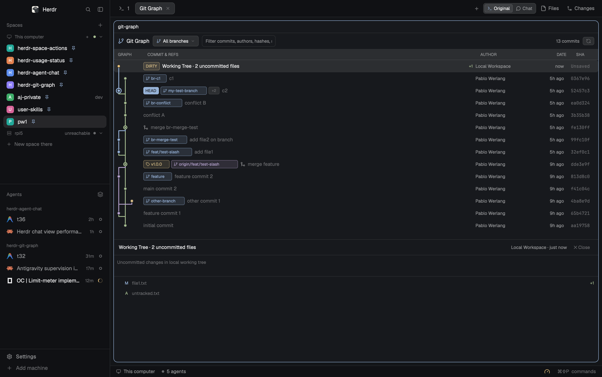

# Git Graph

A native, interactive Git graph viewer inside Herdr featuring topological branch lanes, commit history, working tree inspection, hierarchical file tree view, and full-size diff tabs powered directly by GPUI.

## What you see

Inside any Herdr split pane, dedicated tab, or sidebar panel, you see a full visual Git graph interface:

- **Toolbar**: Shows the mod brand with vector branch icon, branch selector dropdown (`All branches`, `Current branch`, or specific branch) with ahead/behind counts, one-click **Fetch** / **Pull** / **Push** buttons, a background **Clean tree** agent button, search filter input, commit counter, and refresh button.
- **Commit Table**:
  - **Graph column**: Multi-color topological DAG lanes with smooth node-to-node S-curves that span a full row, side branches that keep their color when they rejoin, pass-through rails, clean edge termination, solid commit dots, and a HEAD halo ring. Virtualized with `uniform_list` and vertical scrollbar for fluid performance.
  - **Commit & Refs column**: Rounded, tinted, clickable ref pills: local branches (`⎇ main`), remote branches without a local counterpart (`⎇ origin/main`), and a local branch paired with its matching remote in one pill (`⎇ main | origin`). Tags keep the tag icon, and the checked-out branch is a `✓ branch` pill. Commit subject follows the pills. Right-clicking a branch badge allows checkout, deletion, or copying name.
  - **Date column**: Compact relative commit timestamp (`now`, `5m`, `2d`); the details panel spells out the `ago` form.
  - **Author column**: Commit author name (collapses on compact screens).
  - **Commit column**: Monospace short hash (collapses on compact screens).
  - The list is a ruled table: a 1px vertical rule closes the graph column and every row carries a bottom separator, with `Graph / Description / Date / Author / Commit` headers.
- **Working Tree Row**: If uncommitted changes exist, a top "DIRTY" row displays with added/deleted counters and connects directly downwards to HEAD in lane 0.
- **In-Progress Banner**: Displays an alert banner during ongoing merges, rebases, cherry-picks, or reverts with one-click Continue and Abort buttons.
- **Details & Diff Tabs**:
  - **Header**: Selected commit subject, full commit hash with one-click Copy SHA button, author email, relative date, and close button.
  - **Changes Tree**: VS Code-style fixed **Changes** header with a count badge and collapse-all chevron, indentation guide lines, folder chevrons, colored language badges, right-aligned status letters (`M`, `A`, `D`, `U`), and colored per-file `+added` / `−deleted` counts (green/red). Untracked files get `+N` from their line count.
  - **Diff Tab**: Clicking a file opens its diff full size in a `Diff · <file>` tab with old/new line gutters, colored additions and deletions, hunk headers, horizontal scrolling, and character-level intra-line highlights. Toolbar buttons switch between **Inline**, **Split** (side by side), and **Stacked** (old above new); the choice is remembered, and both split panes scroll together vertically. Working-tree diffs refresh automatically.
  - **Compact Mode**: The details panel shows the file tree full width when the container is below 560px, and `panel: true` renders the graph as a Files-style card with the compact toolbar.
- **Commit Context Menu & Modals**:
  - Right-click any commit row to open a context menu with Checkout, Create Branch, Add Tag, Cherry Pick, Revert, Reset, Merge, Rebase, Copy SHA, and Copy Subject.
  - Interactive modal dialogs with auto-focused inputs and Enter/Esc keyboard navigation for creating branches, adding tags, or selecting reset modes (Soft, Mixed, Hard).

## How it behaves

- Resolves repository location from `props().folder` or auto-detects from the focused terminal pane, active tab, active space, pinned location, or space folder.
- Pass `panel: true` when the mod sits in a layout panel (for example Herdr's `changes` slot, so the tab-bar Changes button opens the graph instead of the old changes list). The panel gets the Files-style card, a flexing compact toolbar, and an expand button that opens the same repository in a full-size tab.
- Selecting a folder with "Open Repository Folder…" overrides the auto-detected location, ensuring clicks inside the git-graph pane never switch or reset the active repository.
- Live updates when files change via `watchFolder` and periodic 10-second polling.
- Clicking any commit or working tree row opens the details panel and loads the hierarchical file tree.
- Clicking a file in the tree opens its diff in a dedicated Herdr tab with diff syntax highlighting and line numbers; the same file selects its existing tab instead of opening a duplicate. Diff tabs switch between inline, side-by-side and stacked layouts and highlight the exact changed characters.
- Selecting branches via the toolbar dropdown or clicking branch badges in the commit table filters the view to that branch's reachable history, cleanly terminating missing parent connections at the row edge.
- The Fetch / Pull / Push toolbar buttons run the matching git command; push sets the upstream automatically, the selector shows `↑n` / `↓n` against the tracked upstream, and unavailable actions explain why in their tooltip.
- The OpenCode button beside the branch controls launches `opencode mini` through `hc run --bg`. It uses the low-reasoning `opencode-go/deepseek-v4.1-flash#low` variant and sends the current branch, dirty paths, and in-progress operation. The agent follows `git-change-workflow`, resolves merge/rebase/cherry-pick conflicts, completes the operation, and makes atomic commits on the current branch; it is told never to push. When the tree is dirty, the branch dropdown also offers **Clean tree with OpenCode Mini**.
- Typing in the search input filters commits in real time by subject, author, email, hash, or ref name, and dynamically recalculates graph lanes on the filtered subset.
- Right-clicking any commit opens a native in-component context menu with 10 Git commands.
- Mutating actions (checkout, branch, tag, cherry-pick, revert, reset, merge, rebase) show toast notifications and automatically refresh the graph.
- Supports comprehensive keyboard navigation:
  - `↑` / `↓` or `k` / `j` (when not typing in search) moves selection across commits and working tree.
  - `Esc` dismisses dialogs, menus, search focus, or commit details hierarchically. Diff tabs close from the tab bar.
  - `Enter` submits active dialog forms.
  - `r` triggers manual refresh.
  - `b` toggles branch scope (`--all` vs. current branch).

## Built from

- `mods/git-graph/` — the GPUI mod component:
  - `main.js`: Main view component, file tree view, diff editor, branch selector, context menu, and dialogs.
  - `git-logic.js`: Pure functions for topological DAG lane allocation, ref parsing, file tree construction, and diff processing.
  - `mod.json`: Herdr mod manifest (`"place": "none"`, `"focusable": true`).
  - `icons/`: Clean vector SVG icons (`branch.svg`, `tag.svg`, `commit.svg`, `merge.svg`, `refresh.svg`, `copy.svg`, `folder.svg`, `fetch.svg`, `pull.svg`, `push.svg`, `search.svg`, `expand.svg`, `chevron-down.svg`, `chevron-right.svg`).
- `gpui-kit` & `gpui-base` — native GPU elements, flex layouts, virtual lists, focus handles, and text inputs.
- `herdr` module — `exec` (git commands), `hc` (background terminals), `terminals`, `readTextFile`, `watchFolder`, `theme()`, `settings()`, `shared()`, `notify()`, and `nextCommand()`.
- `preview.png` — real window capture showing `git-graph` running in Herdr.

## Watch out

- Keep the mod name `git-graph` stable: asset paths refer to `mods/git-graph/icons/...`.
- Unborn branches (new repositories with no commits yet) display a friendly empty state without failing git execution.
- Large diffs are truncated at 500,000 characters to ensure smooth GPU rendering.
- Lane colors and file status colors are derived dynamically from `theme()` so both dark and light modes maintain high visual contrast.

## Done when

- `herdr-app check` passes for `mods/git-graph` with zero errors.
- Running `./sync.sh` synchronizes the mod to `~/.config/herdr-app/mods/git-graph`.
- Opening in Herdr via `herdr-app do tab.new --name "Git Graph" --mod git-graph --props '{"folder":"/tmp/git-graph-demo"}'` renders the graph and working tree cleanly.
- `herdr-app status` reports `errors: []`.
- `preflight.sh` passes all required checks (`README.md`, `RECIPE.md`, `preview.png`, `mods/git-graph`).
